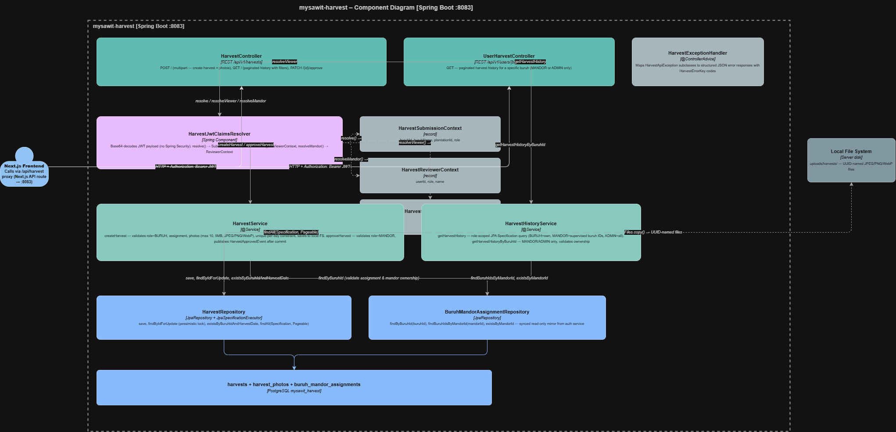
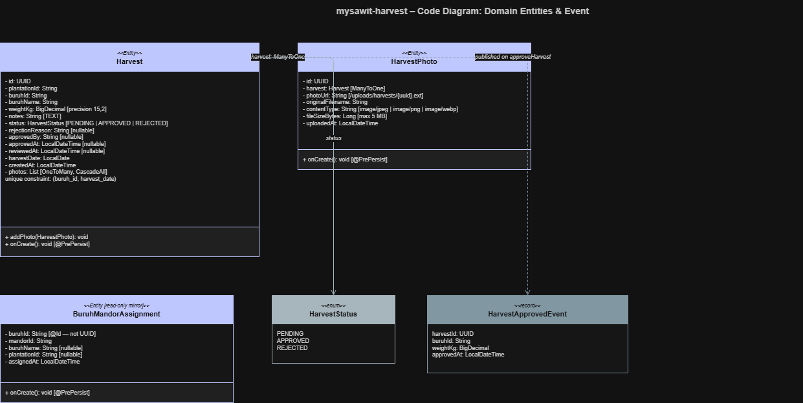
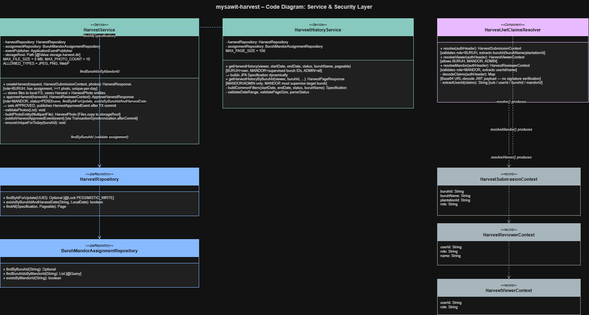

# MySawit Harvest

## Milestone 75 - Harvest Approval Update

Scope milestone 75 untuk bagian Rafsan berfokus pada UC-H02 Approve Harvest.
Target utamanya adalah memastikan Mandor dapat menyetujui laporan harvest Buruh
yang dia supervisi, status berubah menjadi `APPROVED`, event approval dipublish,
dan response approve sesuai API contract.

### Implemented

- Menambahkan controller-level regression tests untuk endpoint:
  `PATCH /api/v1/harvests/{harvestId}/approve`.
- Memperkuat success response test agar mencakup:
  `id`, `status: APPROVED`, `approvedBy`, `approvedAt`, dan
  `payrollStatus: QUEUED`.
- Menambahkan test mapping error approve:
  - `403 FORBIDDEN` untuk caller non-Mandor.
  - `403 MANDOR_NOT_AUTHORIZED` untuk Mandor yang bukan supervisor Buruh.
  - `404 HARVEST_NOT_FOUND` jika harvest tidak ditemukan.
  - `409 HARVEST_ALREADY_REVIEWED` jika harvest sudah `APPROVED`.
  - `409 HARVEST_ALREADY_REVIEWED` jika harvest sudah `REJECTED`.
- Memverifikasi bahwa Harvest backend tidak memiliki direct coupling ke Payment
  module melalui static search pada source backend.

### Existing Behavior Confirmed

- `HarvestService.approveHarvest(...)` sudah mengubah status harvest menjadi
  `APPROVED`.
- Approval menyimpan `approvedBy`, `approvedAt`, dan `reviewedAt`.
- Approval hanya dapat dilakukan oleh Mandor yang mensupervisi Buruh pemilik
  harvest.
- Harvest yang sudah direview tidak dapat diproses ulang.
- `HarvestApprovedEvent` sudah berisi `harvestId`, `buruhId`, `weightKg`, dan
  `approvedAt`.
- Event dipublish setelah transaction commit menggunakan Spring transaction
  synchronization.
- Response approve menyertakan `payrollStatus: "QUEUED"`.

### Verification

- Backend Harvest test suite:
  `.\gradlew.bat test` passed.
- Frontend lint:
  `npm run lint` passed dari `mysawit-frontend`.
- Static Payment coupling check:
  `rg -n "Payment|payment" mysawit-harvest\src\main\java` tidak menemukan
  direct Payment dependency.

### Commit Created

- `2e6e02b test: strengthen harvest approval controller tests`

Commit tersebut dibuat di nested repository `mysawit-harvest` pada branch
`staging`.

## Individual Architecture Diagram - Rafsan

### Component Diagram

Diagram ini menjelaskan komponen yang saya kerjakan pada project kelompok,
yaitu bagian fitur Harvest Approval.

### Code Diagram

Diagram ini menjelaskan relasi class/module/function utama pada implementasi
fitur saya.

### Notes

- `PATCH /api/v1/harvests/{harvestId}/reject` masih di luar core scope
  milestone 75 dan belum diimplementasikan pada perubahan ini.
- `gradlew check` masih membutuhkan cleanup Checkstyle line length terpisah.
- README ini sengaja belum dicommit.
